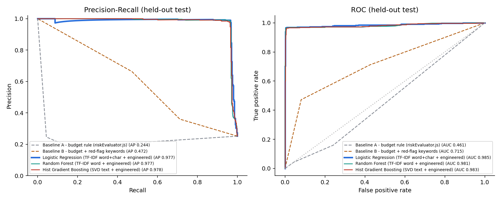
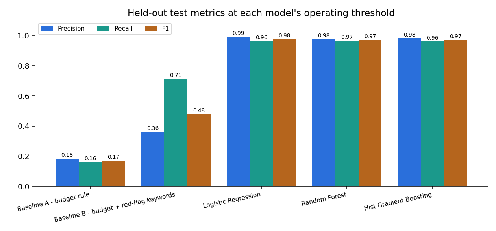
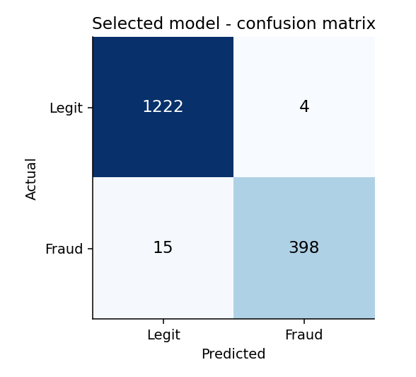
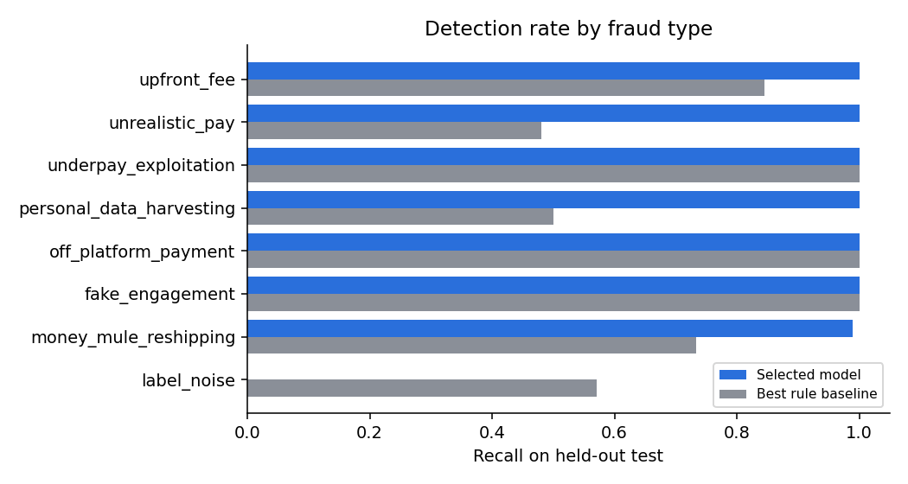
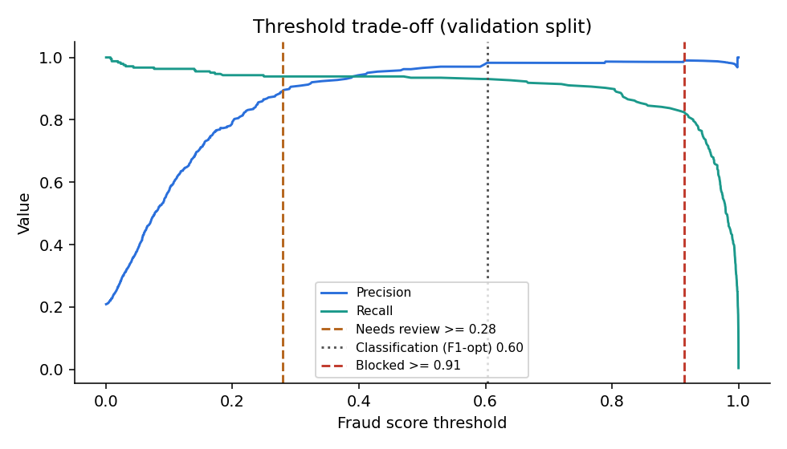
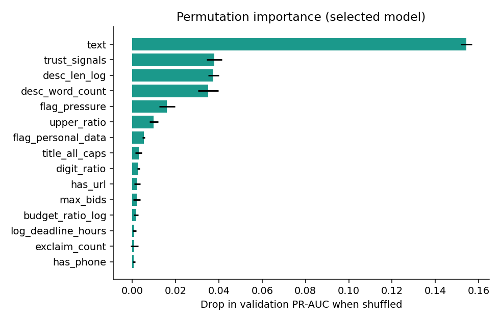
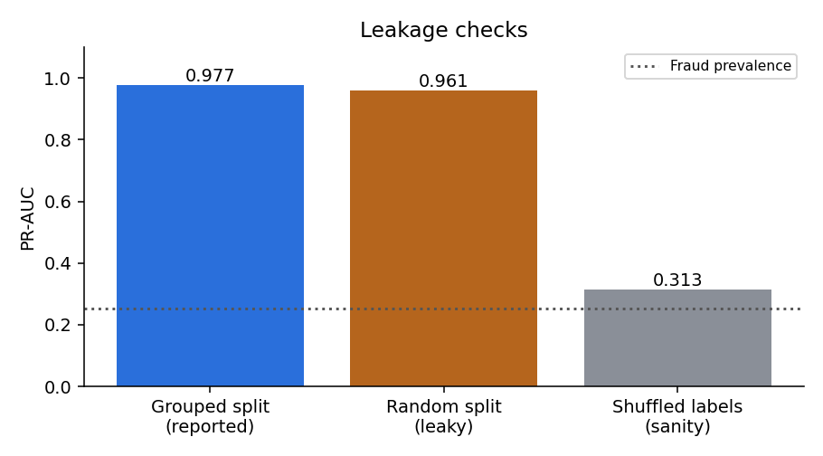

# ConnectMyTask - Fraud Task Detection AI: Model Comparison and Evaluation Report

*Generated 2026-11-24T01:47:30 by `ai/train.py` - scikit-learn 1.7.2 - data `synthetic_tasks.csv` (sha256 916f649e267700a8)*

## 1. Summary

- **Selected model:** Logistic Regression (TF-IDF word+char + engineered) (`C=1.0`), chosen on the validation split by PR-AUC.
- **Held-out test (never used for training, tuning or selection):** PR-AUC **0.977**, ROC-AUC 0.985, precision 99.0%, recall 96.4%, F1 **0.977**, false-positive rate 0.3%.
- **Best rule-based baseline** (Baseline B - budget + red-flag keywords): PR-AUC 0.472, F1 0.478, recall 71.2%, false-positive rate 42.6%.
- **Outperforms baseline:** YES - F1 gain +0.498 (95% paired-bootstrap CI +0.462 to +0.535; statistically clear).
- **Leakage checks:** no requester/campaign appears in both train and test; no label or identifier columns in the features; a model trained on shuffled labels scores PR-AUC 0.313 (prevalence 0.252), i.e. nothing leaks.
- **Novel scam patterns:** when a fraud type is removed from training entirely, the model still catches 31.3% of it on average (worst: underpay_exploitation 0.0%) - the realistic expectation for scams it has never seen (Section 6.1).
- **Hybrid ML + rules** (what the API runs) raises unseen-type recall to 71.0% with a 8.2% legit false-positive rate.
- **API decision bands** (tuned on validation): score < 0.28 -> APPROVED, 0.28-0.91 -> NEEDS_REVIEW (admin queue), >= 0.91 -> BLOCKED. Classification metrics use the F1-optimal threshold 0.60.
- **Latency:** 2.8 ms per task on this machine (single prediction).

## 2. Alignment with the Project B plan

| Plan requirement (Fraud AI, P0 / Definition of Done) | How it is met here |
|---|---|
| Select a final model | 3 ML families x 2-3 configs compared on a validation split; best by PR-AUC (Section 5) |
| Evaluate on a held-out test set | Grouped 20% test split, scored once after selection (Section 6) |
| Check for data leakage | Group-disjoint splits, feature audit, duplicate scan, random-vs-grouped split, label permutation, single-feature scan (Section 7) |
| Outperform the rule-based baseline | Compared with the live `riskEvaluator.js` rule and a keyword-rule checklist, with bootstrap CI (Sections 5-6) |
| Rule-based baselines remain as fallbacks | API falls back to Baseline B if the model file is missing (`app/main.py`) |
| Prediction API integrated into task flow | FastAPI `POST /api/tasks` validates every posted task; output mirrors `Task.isSuspicious / riskLevel / suspiciousReason` |
| Documented metrics | This report, `metrics.json`, `model_comparison.csv`, `test_predictions.csv` |

## 3. Data

Synthetic task postings from `data/generate_synthetic_tasks.py` - **8,007 tasks**, 25.8% fraud, 2,071 requesters/scam campaigns. Columns follow the ConnectMyTask *Post a Task* form: `title`, `description`, `category`, `district` (HCMC ward), `street_name`, `budget_vnd`, `max_bids`, `deadline`, `urgency`, `image_count`. Labels: `is_fraud`, `fraud_type`.

| Fraud type | Rows | What it looks like |
|---|---|---|
| upfront_fee | 396 | Provider must pay a fee/deposit before working |
| off_platform_payment | 322 | Moves contact/payment to Zalo, Telegram, cash (bypasses escrow) |
| unrealistic_pay | 317 | Trivial work, huge pay |
| underpay_exploitation | 284 | Normal-looking big job at a fraction of the fair price |
| personal_data_harvesting | 278 | Asks for CCCD, bank login, OTP |
| money_mule_reshipping | 232 | Reship parcels or pass money on |
| fake_engagement | 142 | Fake reviews, ratings, ad clicks |
| label_noise | 120 | 1.5% randomly flipped labels (imperfect moderation) |

Realism built into the generator: ~30% of scam campaigns hide the scam inside a normal task description, ~15% keep only one weak cue, ~35% of phone numbers are obfuscated, ~8% of legitimate tasks are cheap enough to trip the budget rule, and legitimate posts mention *deposit*, *escrow* and *urgent*. Location is **not** a model input (fairness and address privacy).

**Splits (grouped by requester/campaign):** train 5,190 (27.0% fraud) - validation 1,178 (20.9%) - test 1,639 (25.2%).

## 4. Features

- **Text:** title + description -> TF-IDF word 1-2 grams (+ char 3-5 grams for Logistic Regression, robust to `z.a.l.o`-style obfuscation).
- **Category:** one-hot.
- **Engineered (28):** `log_budget`, `budget_ratio_log`, `budget_below_min`, `budget_far_below_min`, `budget_far_above_min`, `log_deadline_hours`, `is_urgent`, `max_bids`, `image_count`, `title_len`, `desc_len_log`, `desc_word_count`, `upper_ratio`, `title_all_caps`, `exclaim_count`, `digit_ratio`, `has_phone`, `has_url`, `has_handle`, `money_mentions`, `trust_signals`, `flag_off_platform`, `flag_upfront_fee`, `flag_personal_data`, `flag_unrealistic_pay`, `flag_money_mule`, `flag_fake_engagement`, `flag_pressure`.
- Budget is compared with the same per-category minimums as `riskEvaluator.js`. All vectorisers/scalers are fitted inside the pipeline on the training split only.

## 5. Model comparison

Validation scores drive selection; test columns are shown for transparency only (computed after selection).

| Model | Type | Config | Val PR-AUC | Val F1 | Test PR-AUC | Test ROC-AUC | Test Precision | Test Recall | Test F1 | Test FPR | Fit (s) |
|---|---|---|---|---|---|---|---|---|---|---|---|
| Baseline A - budget rule (riskEvaluator.js) | rule-based baseline | fixed rules | 0.230 | 0.203 | 0.244 | 0.461 | 18.2% | 16.0% | 0.170 | 24.1% | 0.0 |
| Baseline B - budget + red-flag keywords | rule-based baseline | fixed rules | 0.516 | 0.479 | 0.472 | 0.715 | 36.0% | 71.2% | 0.478 | 42.6% | 0.0 |
| Logistic Regression (TF-IDF word+char + engineered) **(selected)** | machine learning | C=1.0 | 0.957 | 0.956 | 0.977 | 0.985 | 99.0% | 96.4% | 0.977 | 0.3% | 1.7 |
| Random Forest (TF-IDF word + engineered) | machine learning | trees=400,min_leaf=1 | 0.946 | 0.947 | 0.977 | 0.981 | 97.6% | 96.6% | 0.971 | 0.8% | 0.9 |
| Hist Gradient Boosting (SVD text + engineered) | machine learning | lr=0.1 | 0.950 | 0.958 | 0.978 | 0.983 | 98.0% | 96.1% | 0.971 | 0.7% | 1.9 |





<details><summary>Hyper-parameter search (validation PR-AUC)</summary>

| Family | Config | Val PR-AUC | Fit (s) |
|---|---|---|---|
| Logistic Regression (TF-IDF word+char + engineered) | C=0.3 | 0.9559 | 1.5 |
| Logistic Regression (TF-IDF word+char + engineered) | C=1.0 | 0.9569 | 1.7 |
| Logistic Regression (TF-IDF word+char + engineered) | C=3.0 | 0.9550 | 2.1 |
| Random Forest (TF-IDF word + engineered) | trees=400,min_leaf=1 | 0.9463 | 0.9 |
| Random Forest (TF-IDF word + engineered) | trees=400,min_leaf=3 | 0.9459 | 0.9 |
| Hist Gradient Boosting (SVD text + engineered) | lr=0.05 | 0.9487 | 2.5 |
| Hist Gradient Boosting (SVD text + engineered) | lr=0.1 | 0.9505 | 1.9 |

</details>

## 6. Selected model on the held-out test set

Operating threshold 0.603 (F1-optimal on validation). TP 398 - FP 4 - TN 1222 - FN 15. Brier score 0.019.

- 95% bootstrap CI: F1 0.965-0.987, PR-AUC 0.960-0.990.
- vs best baseline: PR-AUC gain CI +0.457 to +0.548.
- On the 97.5% of test tasks whose normalised text never appears in training: PR-AUC 0.977, F1 0.977.



**Recall by fraud type (test):**

| Fraud type | Test rows | Model recall | Baseline recall |
|---|---|---|---|
| fake_engagement | 21 | 100.0% | 100.0% |
| label_noise | 14 | 0.0% | 57.1% |
| money_mule_reshipping | 94 | 98.9% | 73.4% |
| off_platform_payment | 22 | 100.0% | 100.0% |
| personal_data_harvesting | 66 | 100.0% | 50.0% |
| underpay_exploitation | 18 | 100.0% | 100.0% |
| unrealistic_pay | 75 | 100.0% | 48.0% |
| upfront_fee | 103 | 100.0% | 84.5% |



**False-positive rate on legitimate tasks by category (test)** - checks no category is unfairly flagged:

| Category | Legit test tasks | FPR |
|---|---|---|
| CLEANING | 175 | 0.0% |
| DELIVERY | 181 | 0.0% |
| HOME_REPAIR | 177 | 1.1% |
| IT_SUPPORT | 156 | 0.0% |
| MOVING | 122 | 1.6% |
| OTHER | 102 | 0.0% |
| PERSONAL_ASSISTANT | 128 | 0.0% |
| TUTORING | 185 | 0.0% |

**Decision bands used by the API (test):**

| Band | Tasks | Actual fraud rate |
|---|---|---|
| APPROVED | 1190 | 1.1% |
| NEEDS_REVIEW | 88 | 46.6% |
| BLOCKED | 361 | 99.4% |



### 6.1 Generalisation to scam types never seen in training

Each fraud type is removed from the training split in turn; the model is retrained and scored on that type in the test split. Synthetic posts of one type share phrasing across campaigns, so the *seen* recall is optimistic; the *unseen* recall is the better estimate for a brand-new scam pattern on ConnectMyTask.

| Fraud type (held out) | Test rows | ML recall when seen | ML recall when unseen | Rule baseline recall | **Hybrid recall when unseen** | ML legit FPR | Hybrid legit FPR |
|---|---|---|---|---|---|---|---|
| fake_engagement | 21 | 100.0% | 71.4% | 100.0% | **100.0%** | 0.3% | 8.2% |
| money_mule_reshipping | 94 | 98.9% | 11.7% | 73.4% | **71.3%** | 0.2% | 8.2% |
| off_platform_payment | 22 | 100.0% | 9.1% | 100.0% | **59.1%** | 0.3% | 8.2% |
| personal_data_harvesting | 66 | 100.0% | 48.5% | 50.0% | **56.1%** | 0.3% | 8.2% |
| underpay_exploitation | 18 | 100.0% | 0.0% | 100.0% | **72.2%** | 0.3% | 8.2% |
| unrealistic_pay | 75 | 100.0% | 37.3% | 48.0% | **70.7%** | 0.3% | 8.2% |
| upfront_fee | 103 | 100.0% | 40.8% | 84.5% | **68.0%** | 0.3% | 8.2% |

**Hybrid policy used by the API:** a task is sent to NEEDS_REVIEW if the ML score is in the review band *or* the keyword rule scores >= 1.0 (two or more red-flag families, or budget under half the category minimum). For unseen scam types this lifts average recall from 31.3% to 71.0%, at a legit false-positive rate of 8.2%. This is the plan's 'rule-based baselines remain as fallbacks' put into practice.

**Top features (permutation importance on validation; `text` = all title/description words together):**

| Feature | Drop in PR-AUC |
|---|---|
| `text` | 0.1544 +/- 0.0026 |
| `trust_signals` | 0.0378 +/- 0.0036 |
| `desc_len_log` | 0.0375 +/- 0.0024 |
| `desc_word_count` | 0.0351 +/- 0.0048 |
| `flag_pressure` | 0.0160 +/- 0.0037 |
| `upper_ratio` | 0.0099 +/- 0.0019 |
| `flag_personal_data` | 0.0052 +/- 0.0006 |
| `title_all_caps` | 0.0029 +/- 0.0015 |
| `digit_ratio` | 0.0028 +/- 0.0006 |
| `has_url` | 0.0022 +/- 0.0013 |
| `max_bids` | 0.0020 +/- 0.0016 |
| `budget_ratio_log` | 0.0018 +/- 0.0010 |
| `log_deadline_hours` | 0.0010 +/- 0.0008 |
| `exclaim_count` | 0.0009 +/- 0.0018 |
| `has_phone` | 0.0007 +/- 0.0006 |



## 7. Data-leakage checks

| Check | Result | Pass? |
|---|---|---|
| Requester/campaign overlap train-test / val-test / train-val | 0 / 0 / 0 | PASS |
| Label/ID/location columns in model input | none | PASS |
| Test rows whose exact (digit-normalised) text is in train | 41 (2.5%) - generic legit posts from shared templates; metrics on unseen text reported above | INFO |
| Random split vs grouped split PR-AUC | 0.961 vs 0.977 (F1 0.972 vs 0.977); difference -0.016. Near-duplicate posts give little advantage here; the grouped (unseen requester/campaign) number is the one reported | PASS |
| Shuffled-label model PR-AUC (should be ~ prevalence 0.252) | 0.313 | PASS |
| Single engineered feature with ROC-AUC > 0.97 on its own | none (top: `log_deadline_hours` 0.745, `trust_signals` 0.735, `image_count` 0.674, `flag_pressure` 0.655, `digit_ratio` 0.649) | PASS |
| Preprocessing fitted on training data only | TF-IDF/SVD/scaler inside the sklearn Pipeline | PASS |
| Thresholds chosen without test data | Tuned on validation split | PASS |



## 8. Limitations and next steps

- The data is **synthetic**. The red-flag lexicon and the generator were written by the same team, so absolute scores are optimistic; the *relative* comparison and the leakage method are the deliverable. Re-run `ai/train.py --data` on moderator-labelled ConnectMyTask tasks (Task.isSuspicious / admin review outcomes) before production use.
- English-only text; Vietnamese and mixed-language posts need Vietnamese tokenisation or a multilingual encoder.
- Text-only signals: account age, past disputes, payment and bid behaviour (User/Bid/Dispute tables) would add strong signals and should be joined in a v2 user-level model.
- NEEDS_REVIEW tasks should go to the existing admin review flow (`reviewedByAdminAt`) and the decisions fed back as labels.

## 9. Reproduce

```powershell
.venv\Scripts\python data\generate_synthetic_tasks.py
.venv\Scripts\python -m ai.train
```
